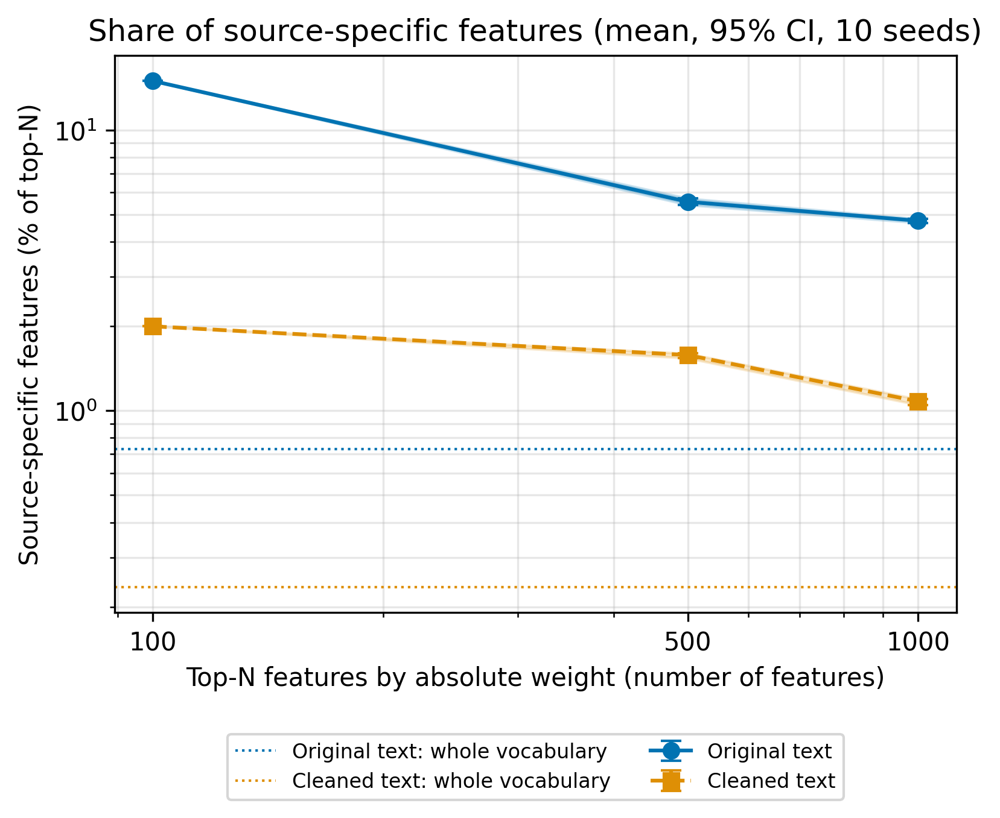
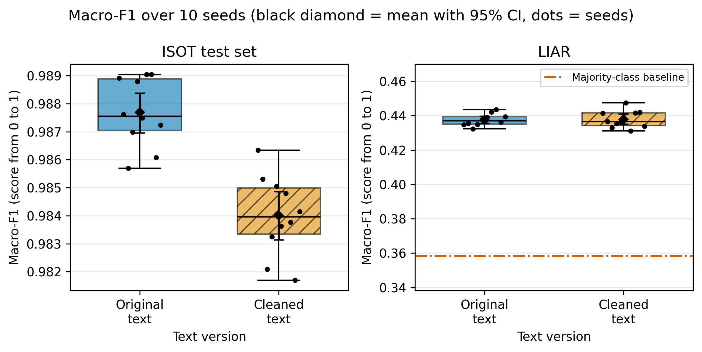

# Which Text Features Cause Performance Degradation of Fake News Classifiers on Unseen Data?

**Authors:** Ashim Burabayev, Ibrakhim Olzhabai (Narxoz University)

## Overview

Fake news classifiers usually work much worse on data from another source than on the
data they were trained on. In this project we train a TF-IDF + Logistic Regression
classifier on the ISOT dataset and test it on the LIAR dataset. We also check whether
source-specific features, such as agency names, image credits and links, cause the
drop in performance.

## Research Question

Which text features cause performance degradation of fake news classifiers on unseen data?

- **RQ1:** How much do F1 and accuracy drop when a model trained on ISOT is tested on LIAR?
- **RQ2:** How much do the highest-weighted features rely on source-specific clues?
- **RQ3:** How does removing source-specific features affect performance on LIAR?

## Repository Structure

```
Fake-News-Classifiers/
├── configs/
│   └── config.yaml              # all parameters
├── data/
│   ├── sample/                  # sample
│   ├── raw/
│   │   └── test_run.jsonl       # raw results of every run
│   └── processed/
│       ├── metrics_summary.csv  # mean, SD, median, p95, p99, bootstrap 95% CI
│       └── hypothesis_tests.csv # tests for H1, H2, H3 and guardrails
├── docs/
│   └── domain_model.md          # loss function, metrics, notation table (LaTeX)
├── notebooks/
│   └── 01_data_analysis.ipynb   # data analysis with all outputs
├── reports/
│   └── figures/                 # figures in .pdf and .png (300 DPI)
├── src/
│   ├── main.py                  # runs the experiment, writes data/raw/test_run.jsonl
│   ├── process_data.py          # filtering, statistics, hypothesis tests
│   └── visualize.py             # figures
├── Dockerfile
├── requirements.txt
├── .gitignore
├── LICENSE
└── README.md
```

## Planned Benchmarks

```
| ID | Hypothesis | Train data | Test data | Independent variable | Metrics |
|----|------------|------------|-----------|----------------------|---------|
| B0 | – | – | LIAR | – | majority-class baseline: F1, accuracy |
| B1 | RQ1 | ISOT train (raw text) | ISOT test vs. LIAR | test data source | F1, accuracy |
| B2 | RQ2 | ISOT train (raw text) | – | feature rank by weight (top-100, 500, 1000) | share of source-specific features in top-N vs. vocabulary |
| B3 | RQ3 | ISOT train (raw vs. clean text) | ISOT test, LIAR | text version | F1, accuracy |
```

Each benchmark is repeated with 10 random seeds.

## Results & Discussion

**Baseline** is the model trained on the original (raw) text, **Proposed** is the model trained on text
cleaned of source-specific patterns. Values are Mean ± SD over 10 seeds.

```
| Metric | Test set | Baseline (raw text) | Proposed (cleaned text) | Majority class |
|--------|----------|---------------------|-------------------------|----------------|
| F1 | ISOT test | 0.9877 ± 0.0012 | 0.9840 ± 0.0014 | – |
| F1 | LIAR | 0.4376 ± 0.0035 | 0.4379 ± 0.0050 | 0.3583 |
| Accuracy | ISOT test | 0.9878 ± 0.0012 | 0.9841 ± 0.0014 | – |
| Accuracy | LIAR | 0.4755 ± 0.0017 | 0.4750 ± 0.0022 | 0.5584 |
```

Median (p25–p75) of F1 on LIAR: raw 0.4370 (0.4351–0.4393), cleaned 0.4365 (0.4343–0.4416).
All 95% confidence intervals are bootstrap intervals (10 000 resamples, fixed seed 42)

Share of source-specific features among the top-N features by absolute weight (mean over 10 seeds):

```
| Top-N | Raw text | Cleaned text |
|-------|----------|--------------|
| 100 | 15.0% | 2.0% |
| 500 | 5.56% | 1.58% |
| 1000 | 4.76% | 1.08% |
| Whole vocabulary | 0.73% | 0.23% |
```





- The model works almost perfectly on ISOT (F1 about 0.99) and close to chance on LIAR. Its accuracy on LIAR (0.475)
  is even lower than the accuracy of always predicting the most frequent class (0.558).
- The model does rely on source clues: 15% of its 100 most important features are source-specific, while they are
  only 0.73% of the vocabulary. Cleaning reduces this share to 2%.
- However, removing these clues does not improve the results on LIAR. So the drop is not explained only by the
  source-specific words we removed. A likely reason is deeper: ISOT consists of long news articles,
  LIAR of short political claims, and the labels have a different meaning

Definition of the loss function, target metrics, hypothesis tests and the notation table are in [docs/domain_model.md](docs/domain_model.md).


### Hypotheses

```
| Hypothesis | Result | Evidence |
|------------|--------|----------|
| H1: drop on unseen data | **supported** | F1 drops by 0.550 (95% CI 0.548–0.552), accuracy by 0.512; paired one-sided t-test p < 1e-21 |
| H2: reliance on source-specific features | **supported** | the share in top-100 is 15% vs. 0.73% in the vocabulary; binomial test, worst p-value over seeds < 0.03 for all N and both text versions |
| H3: cleaning helps on LIAR | **not supported** | change of F1 +0.0004, 95% CI from −0.0032 to +0.0037 includes 0; gain in 6 of 10 seeds |
| Guardrails | passed | F1 on ISOT falls by at most 0.0053 after cleaning (limit 0.02); no texts in both train and test |
```


## Quickstart

- Install the libraries:
   ```bash
   pip install -r requirements.txt
   ```
- Download datasets (they are not stored in this repository) and put them here:
   - ISOT (`True.csv`, `Fake.csv`) into `data/isot/`
   - LIAR (`train.tsv`, `valid.tsv`, `test.tsv`) into `data/liar/`
- Run:
   ```bash
   python src/main.py
   python src/process_data.py
   python src/visualize.py
   ```
- Open `notebooks/01_data_analysis.ipynb` and make **Restart → Run All**.


## Data

- **ISOT Fake News Dataset**
  <https://www.kaggle.com/datasets/clmentbisaillon/fake-and-real-news-dataset>
- **LIAR**
  <https://www.kaggle.com/datasets/doanquanvietnamca/liar-dataset>


## License

MIT   